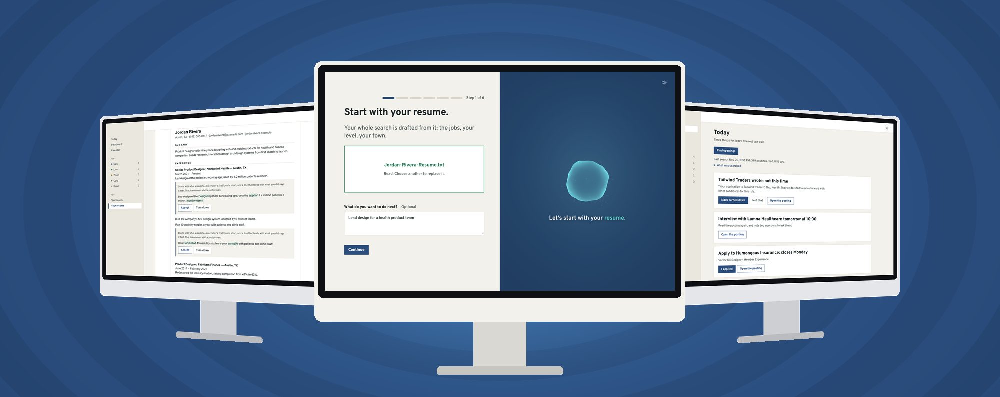
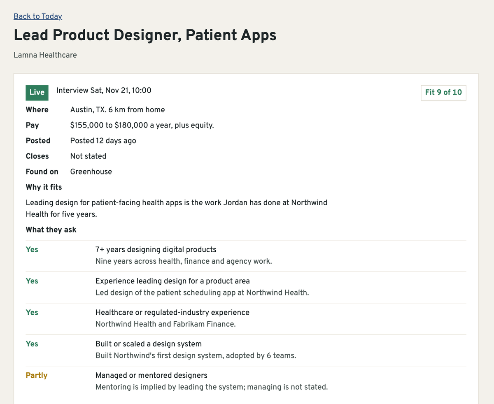
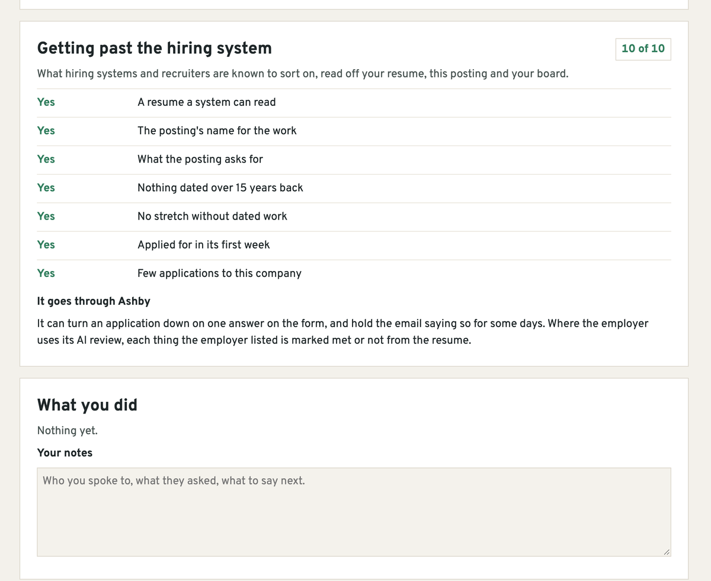
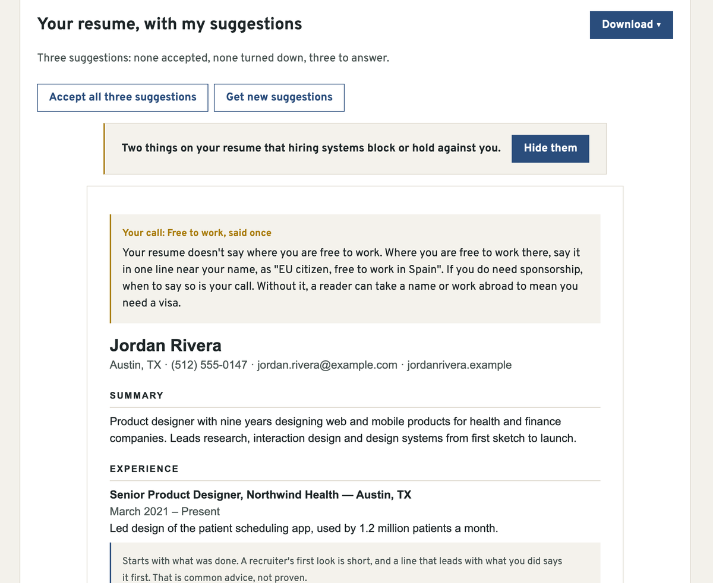
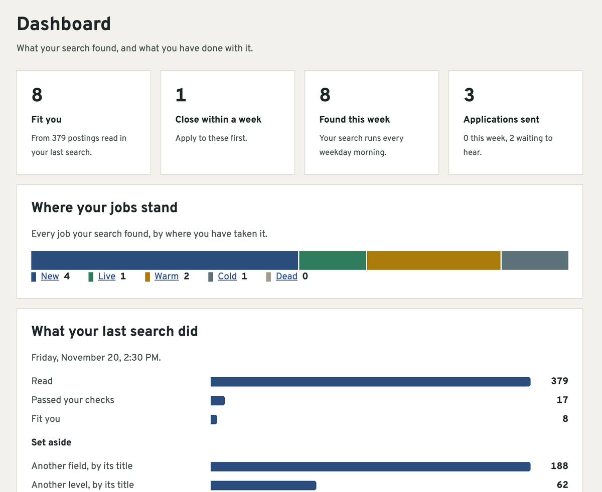

  
  <h1>Warmline Personal</h1>
  
<b>Looking for work is a full-time job. Warmline Personal takes the painful part.</b> Every weekday morning it finds jobs that fit you, and gets your resume past the systems built to block it. All of it on your own computer.

  

    
    
    
    
  

  

    
    
  

  

<table>
  <tr>
    <td width="33%" valign="top"><b>Your resume</b> Every change suggested. None made without your yes.</td>
    <td width="34%" valign="top"><b>Jillian</b> She walks you through setup, out loud.</td>
    <td width="33%" valign="top"><b>Today</b> Three things to do today. The rest can wait.</td>
  </tr>
</table>

Let's be honest. Looking for work is a full-time job. Without the pay.

And every time, you start all over again. Fix the resume. Trawl the job boards. Apply. Wait. Your resume goes into a black hole, and nobody tells you why.

Here's why. A person often never reads it. A hiring system does, and those systems are built to block, not to accept. They don't care about your skills. A graduation year from 1998. Six months at home with your kids. A town they think is too far away. Any of it can sink you before anyone sees your name.

So, don't give them anything to filter.

That's the job I built Warmline Personal for. It does the painful part, so you can focus on the part that matters: talking to people.

## What it does every morning

- **Finds jobs that fit you.** It reads hundreds of postings on job boards, and on companies' own careers pages if you turn on advanced search. It keeps the ones that match your work, your level and how far you'll travel. On its first real run it read 729 postings and kept the 18 that fit, in 7 minutes.
- **Skips the dead ones.** A job posted 60 days ago isn't a real job. Neither is one that already closed. It sets them aside and tells you how many.
- **Says why each one fits.** Every job gets a score out of 10, built from what the posting asks for and whether your resume shows it. Yes, partly or no, with the reason.
- **Reads your resume like a hiring system does.** Can a system read it? Does it have your dates, your town, your headings? Then it reads it like a person with a bias might, for two dozen signs of your age, family, origin, faith or health. Each comes with a fix, and with how strong the evidence behind it is.
- **Finds the work your resume forgot.** With your OK, it reads your LinkedIn, your email and your folders for clients and projects your resume leaves out.
- **Notices when they write back.** "Not this time." "Can you talk Tuesday?" It puts the reply at the top of your day, and you decide what it means.

You see every suggestion. You choose what to use. Nothing in your resume changes without your yes, and Warmline Personal never applies, sends or posts anything for you.

<table>
  <tr>
    <td width="50%" valign="top"> <b>Why it fits</b> Each thing the posting asks for, and whether your resume shows it.</td>
    <td width="50%" valign="top"> <b>Getting past the hiring system</b> What the employer's system will weigh against this one application.</td>
  </tr>
  <tr>
    <td width="50%" valign="top"> <b>What could be held against you</b> Shown on the line it's found on, with the fix.</td>
    <td width="50%" valign="top"> <b>Where your search stands</b> What it read, what it set aside and why, and what you've done.</td>
  </tr>
</table>

Every screen shows a made-up job seeker and made-up companies.

## Who it's for

Anyone looking for work. Laid off. Changing careers. Coming back after time away. Or just tired of shouting into the void.

If you're out of work, there's pressure on you from every side. Warmline Personal was built for that. It won't nag you. It gives you at most three things to do today, and the rest can wait.

## Your stuff stays yours

Warmline Personal runs on your own computer, AI included. It only reads what you give it: your email, your LinkedIn, your folders. Your resume and your mail stay on the machine, unless you choose a cloud AI in Settings.

When it searches, it sends the job titles and places you approve. When it looks up a company, it sends the company's name. That's it.

## Get it

| | Download | Runs on | Size |
| --- | --- | --- | --- |
| **Windows** | [Warmline-Personal-0.1.0-windows.zip](https://github.com/MichaelLisboa/warmline-personal/releases/download/v0.1.0/Warmline-Personal-0.1.0-windows.zip) | Windows 10 or 11, 64-bit | 82 MB |
| **Mac** | [Warmline-Personal-0.1.0-mac.pkg](https://github.com/MichaelLisboa/warmline-personal/releases/download/v0.1.0/Warmline-Personal-0.1.0-mac.pkg) | Apple silicon, macOS 13 or later | 85 MB |

It's an alpha. Things will break.

## Your computer will complain

The Windows version isn't signed yet, so Windows will ask if you're sure. You're sure.

- **Windows.** Unzip the file first: it won't run from inside the zip. Open the **Warmline Personal** folder and double-click **Warmline Personal.exe**. If you see "Windows protected your PC", choose **More info**, then **Run anyway**.
- **Mac.** Open the installer and it installs. It's signed and notarized by Apple.

## One more download

Sorry. The first time it opens, Warmline Personal fetches its AI: a free program called [Ollama](https://ollama.com), and a model, about 5 GB together. Already have Ollama? It leaves yours alone.

Jillian keeps you company while it downloads. Go make a coffee.

## What you need

- 8 GB of memory, or 16 GB for a faster run
- About 10 GB of free space
- An internet connection the first time, and for each morning's search

## Something broke?

Good. That's what an alpha is for.

[Open an issue](https://github.com/MichaelLisboa/warmline-personal/issues) and tell me what happened, and on which screen. Questions, revelations and insults are all welcome.

Thanks for trying it. And good luck out there.

---

  <a href="https://github.com/MichaelLisboa/warmline-personal/issues">Report a problem</a> | <a href="https://github.com/MichaelLisboa/warmline-personal/releases">All versions</a>

